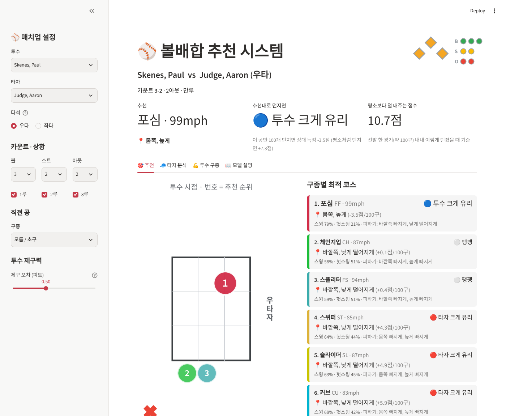
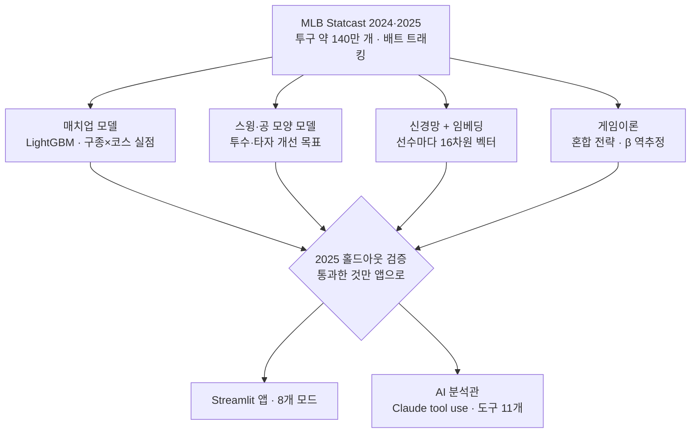
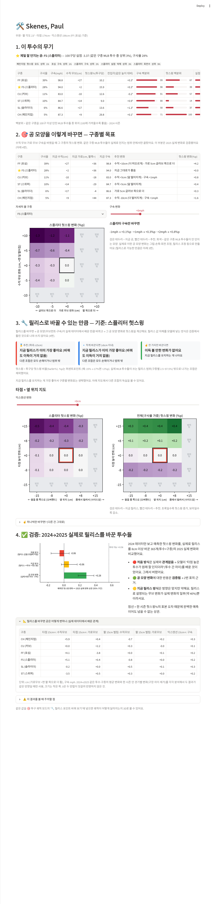
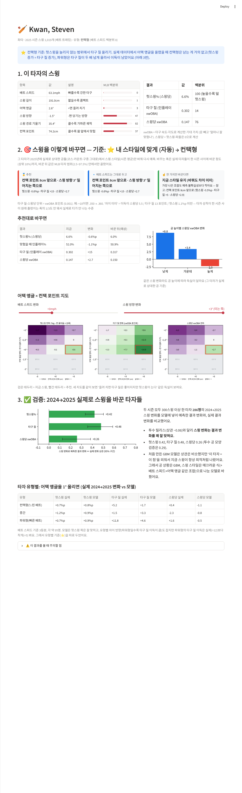
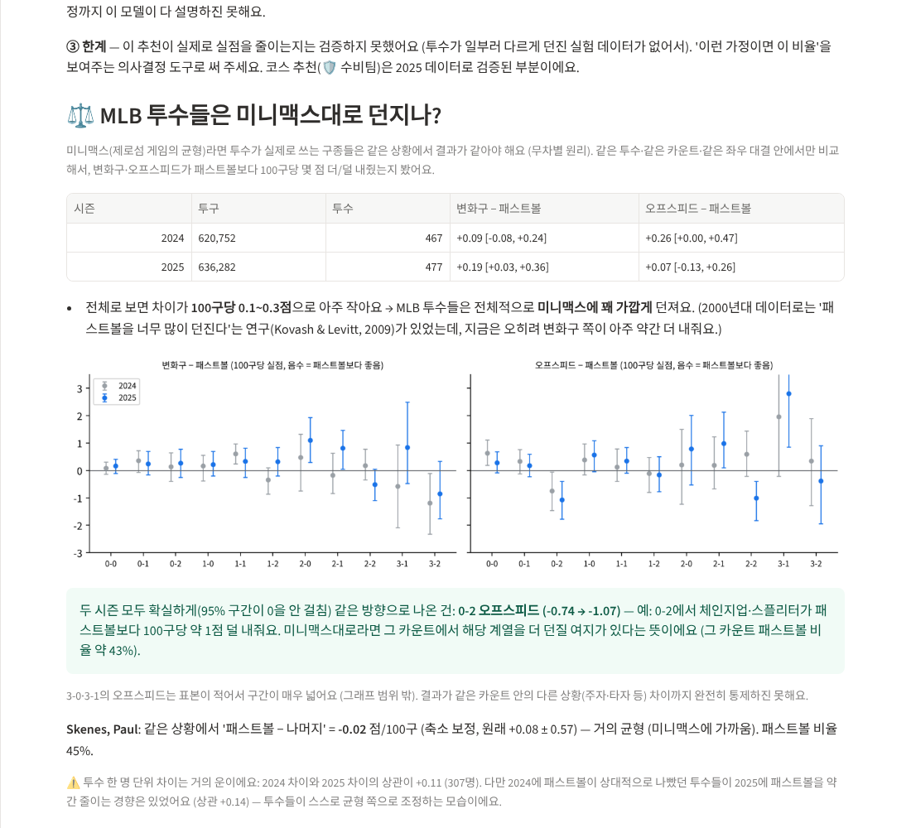
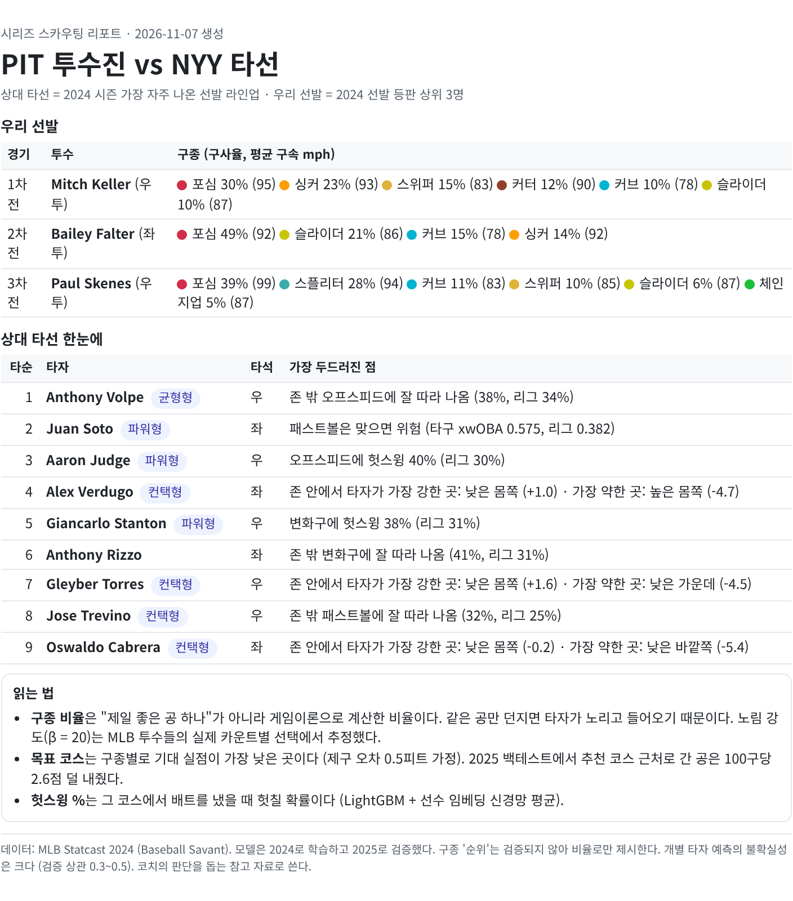
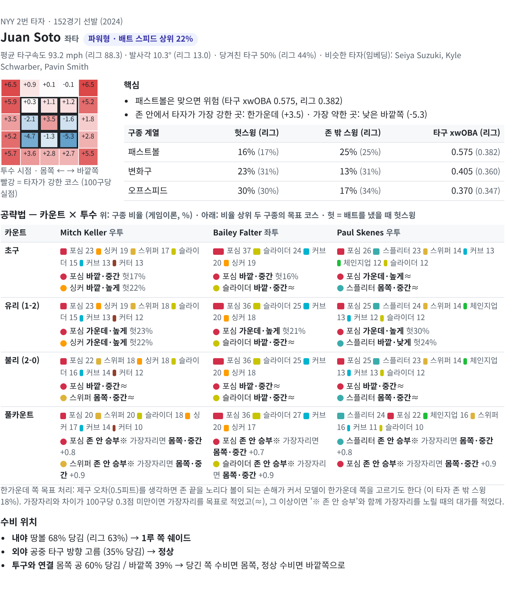

# ⚾ Baseball AI: 검증으로 다듬은 볼배합·선수 개선 시스템

> MLB Statcast 2시즌(약 140만 구)으로 만든 볼배합 추천, 투수·타자 개선, 게임이론 분석 도구.
> 모든 기능은 **2024로 학습하고 2025로 검증**했고, 검증에서 틀린 기능은 고치거나 버렸다.



## 한눈에 보기

| 질문 | 답 (2025 검증 결과) |
| --- | --- |
| 추천 코스대로 던지면 실제로 덜 맞나? | 추천 코스 0.5피트 이내 **−2.58점/100구**, 1.5피트 넘게 벗어나면 **+2.27**. 평소와 다르게 추천 쪽으로 간 공은 평소대로 간 공보다 −4.27 [−7.10, −1.57] |
| 투수 릴리스 위치를 바꾸라는 추천은 맞나? | **아니었다.** 릴리스를 바꾼 365 사례에서 예측력 r = −0.06. 버리고 "공 모양 목표"(r = 0.29)로 대체 |
| 타자 스윙 모델은 정말 스윙을 이해하나? | 첫 모델은 **선수를 외우고 있었다.** 바꾸면 "이 선수"만 남는 구조를 찾아내 다시 설계 |
| 콴 같은 컨택 타자도 어택 앵글을 올려야 하나? | **아니다.** 파워형은 타구 질 +11.8/°, 컨택형은 스윙당 +0.4 [−1.4, +1.9]. 유형별 규칙으로 바꿈 |
| 이걸 구단이 실제로 쓰는 형태로 만들 수 있나? | 상대 타선 9명 × 우리 선발 3명 **시리즈 스카우팅 리포트**를 자동 생성 ([샘플 PDF](docs/sample_scouting_PIT_vs_NYY.pdf)). 검증된 코스 추천만 싣고, 검증 안 된 구종 순위는 게임이론 비율로 대체 |
| MLB 투수는 게임이론(미니맥스)대로 던지나? | 리그 전체는 균형에 가깝다. **0-2 오프스피드만** 두 시즌 연속 패스트볼보다 0.74~1.07점 덜 내줌 |
| 선수 임베딩(딥러닝)이 도움이 되나? | 헛스윙 AUC 0.787 → 0.792, LightGBM과 평균하면 0.797 → 앱의 스윙·헛스윙 확률에 적용. 하지만 **실점 순위**에 섞었을 때는 백테스트 정면 비교에서 차이가 없어 보류 |

자세한 과정(무엇이 틀렸고 어떻게 알았는지)은 [문제 해결 사례집](docs/CASE_STUDY.md)에 있다 (사례 6개).

## 시스템 구조



**검증 원칙**

1. **시간 순서 지키기**: 2024로 학습, 2025로 평가. 하이퍼파라미터도 2024 안에서만 고른다.
2. **자연 실험**: "이걸 바꾸면 좋아진다"는 추천은 실제로 그걸 바꾼 선수들의 다음 시즌 결과로 확인한다.
3. **불확실성 표시**: 모든 수치에 선수 단위 부트스트랩 95% 구간. 측정 오차 때문에 넘을 수 없는 상한(노이즈 천장)도 함께 계산한다.
4. **틀리면 버리기**: 검증에서 예측력이 없던 기능은 구조를 바꾸거나 앱에서 뺐다.

## 앱 모드

| 모드 | 하는 일 |
| --- | --- |
| 🤖 AI 분석관 | 자연어 질문 → Claude가 아래 모델들을 도구로 호출해 근거와 함께 답 (숫자를 지어내지 않음) |
| 🛡️ 수비팀 | 투수 vs 타자, 카운트·주자 상황별 추천 구종·코스, 수비 위치 |
| ⚔️ 공격팀 | 타자 시점: 이 투수에게 노릴 공, 타구 방향 |
| ♟️ 게임이론 볼배합 | 타자의 노림을 고려한 구종 비율(혼합 전략), 미니맥스 검증 결과 |
| 🎯 투구 궤적 | 3D 궤적, 릴리스를 바꿨을 때의 what-if |
| 🛠️ 투수 개선 | 주무기 분석 → 구종별 공 모양(수직·수평 무브, 구속) 목표 |
| 🏏 타자 개선 | 배트 스피드·어택 앵글·컨택 포인트 목표 (타자 유형별 규칙) |
| 🧬 선수 지도 | 임베딩으로 본 비슷한 선수, 2차원 지도 |
| 📋 스카우팅 리포트 | 상대 팀·우리 선발을 고르면 타자당 A4 한 장짜리 공략 리포트 생성 → HTML 내려받기 (인쇄·PDF) |

| 투수 개선 | 타자 개선 (콴) | 미니맥스 검증 |
| --- | --- | --- |
|  |  |  |

## 시리즈 스카우팅 리포트

타자 한 명당 한 장: 핫존·콜드존, 구종 계열별 약점(리그 대비), **카운트 × 선발 투수별 게임이론 구종 비율과 목표 코스**, 수비 위치.

| 표지 (시리즈 요약) | 타자 페이지 (후안 소토) |
| --- | --- |
|  |  |

```bash
python scouting.py --opp NYY --us PIT                       # 상대 = 양키스, 우리 = 피츠버그 선발 3명
python scouting.py --opp LAD --pitchers Skenes Cole Sale    # 선발 직접 지정
```

만드는 과정에서 목표 코스의 절반이 "한가운데"로 나오는 문제를 찾았고, 한가운데와 가장자리의 차이(중앙값 100구당 0.12점)를 근거로 표시 규칙을 정했다 → [사례 6](docs/CASE_STUDY.md).

## 실행 방법

```bash
pip install -r requirements.txt

# 방법 A: 학습된 모델 받아서 바로 실행 (추천)
#   Releases에서 baseball-ai-models.zip을 받아 이 폴더에 압축 풀기
streamlit run app.py          # Windows: run_app.bat 더블클릭

# 방법 B: 데이터 받기부터 학습·검증까지 직접 (몇 시간, 데이터 약 850MB)
python pipeline.py --list     # 단계 목록
python pipeline.py
```

- AI 분석관을 쓰려면 `secrets.toml.example`을 `.streamlit/secrets.toml`로 복사하고 Anthropic API 키를 넣는다. 이 파일은 `.gitignore`에 들어 있다.
- 화면 테스트: `python tests/test_app_defense.py` 등 (Streamlit AppTest)

## 파일 지도

모듈끼리 서로 import 하는 평평한 구조라 한 폴더에 둔다.

| 종류 | 파일 |
| --- | --- |
| 앱 | `app.py` (화면), `analyst.py` (AI 분석관), `scouting.py` (스카우팅 리포트), `recommend.py`, `strategy.py`, `trajectory.py`, `animation.py`, `mechanics.py`, `batter_mech.py`, `embed.py`, `game.py` |
| 학습 | `stuff_plus.py` (데이터 받기 + Stuff+), `build_*.py` (모델별) |
| 검증 | `validate_release.py`, `validate_personal.py`, `backtest.py`, `backtest_ensemble.py`, `test_high_fastball.py`, `build_minimax.py` |
| 검증 결과 | `val_*.csv` (앱의 "근거" 화면이 읽음), `results/*.txt` |
| 순서 | `pipeline.py` |

## 데이터와 라이선스

- **Statcast**: [pybaseball](https://github.com/jldbc/pybaseball)로 Baseball Savant에서 받는다. 원본 데이터는 저장소에 넣지 않았다 (MLB Advanced Media 소유).
- **선수 신체조건**: MLB Stats API (`fetch_bio.py`).
- **OpenBiomechanics(Driveline)**: 개발 중 실제 투구 동작 시각화에 참고했지만, 라이선스가 프로 구단 관계자의 사용을 금지하므로 **이 저장소에는 해당 데이터와 변환 코드를 넣지 않았다.** 앱은 그 파일이 없으면 해당 기능만 건너뛴다.

## 라이선스

코드는 [MIT](LICENSE). Statcast 데이터는 MLB Advanced Media 소유이며, 모델 파일(Releases)은 연구·포트폴리오 확인용이다.

## 한계

- **관측 데이터만 있다.** 볼배합 비율 추천과 타자 노림의 실점 효과는 인과로 검증하지 못했다 (투수가 일부러 다르게 던진 실험이 없음).
- **모션 데이터가 없다.** 개선 추천은 "공 모양"과 "스윙 수치" 목표까지만 말한다. 그 목표를 만드는 방법은 코치와 트래킹 장비의 일이다.
- **개별 선수 예측은 약하다.** 검증 상관 0.3~0.5 수준이라 평균적으로는 맞지만 한 선수에게는 틀릴 수 있다.
- 투수–타자 대결만 다룬다 (수비·주루 제외).
