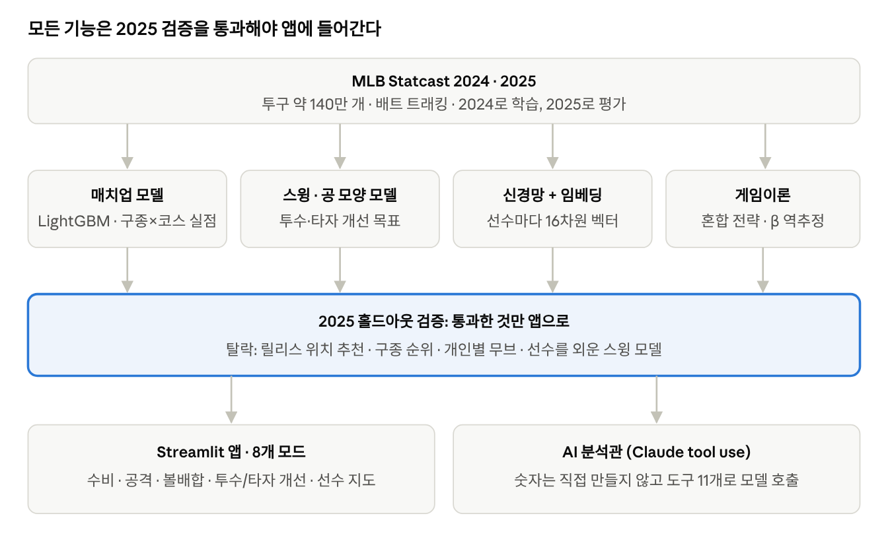
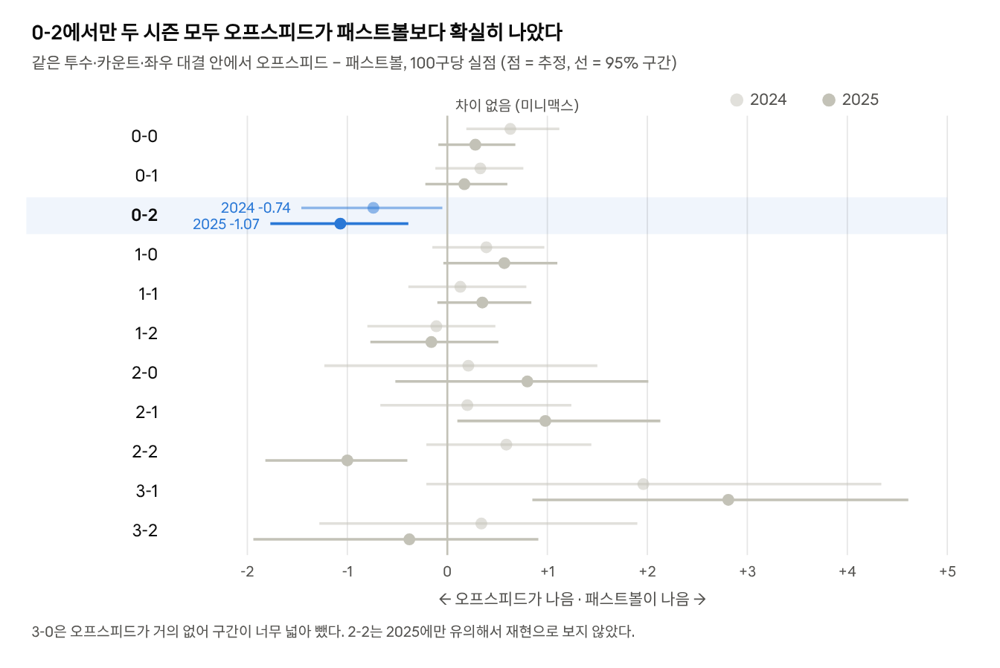
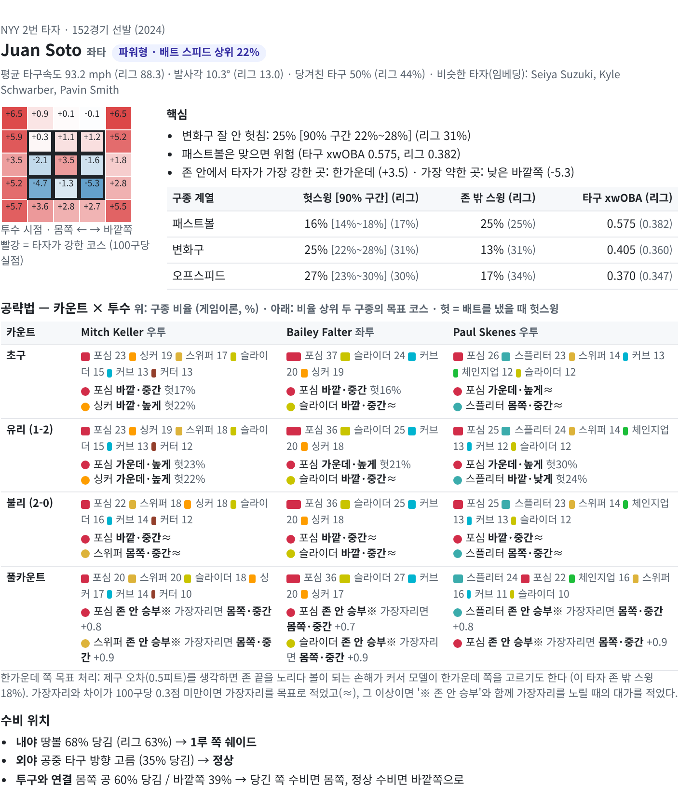

# 야구 AI 프로젝트 — 문제 해결 사례집

[← README](../README.md)

Nov 7, 2026

## 프로젝트 한눈에

MLB 스탯캐스트 2시즌(2024·2025, 투구 약 140만 개)으로 볼배합 추천, 선수 개선, 게임이론 분석을 하는 야구 AI 시스템을 만들었다. 모든 기능은 학습에 쓰지 않은 다음 시즌 데이터로 검증했고, 검증에서 틀린 기능은 고치거나 버렸다.

- **목표**: 구단 분석 시스템(예: 한화 HITS)처럼 코치·선수가 바로 쓸 수 있는 의사결정 도구
- **데이터**: 스탯캐스트 투구 단위 데이터(구속·회전·무브먼트·코스·결과), 배트 트래킹(배트 스피드·어택 앵글 등) (OpenBiomechanics 모션캡처는 개발 중 시각화에만 참고했고, 라이선스 때문에 이 저장소에는 넣지 않았다)
- **결과물**: Streamlit 앱 8개 모드 — AI 분석관(자연어 질의), 수비팀 볼배합, 공격팀 타격 계획, 게임이론 볼배합, 3D 투구 궤적, 투수 개선, 타자 개선, 선수 지도(딥러닝 임베딩)

검증 원칙은 네 가지다.

1. **시간 순서 지키기**: 2024로 학습하고 2025로 평가한다. 하이퍼파라미터도 2024 안에서만 고른다.
2. **자연 실험**: "이걸 바꾸면 좋아진다"는 추천은 실제로 그걸 바꾼 선수들의 다음 시즌 결과로 확인한다.
3. **불확실성 표시**: 모든 수치에 선수 단위 부트스트랩 95% 구간을 붙이고, 측정 오차 때문에 넘을 수 없는 상한도 함께 계산한다.
4. **틀리면 버리기**: 검증에서 예측력이 없던 기능은 구조를 바꾸거나 앱에서 뺐다.

아래 사례 1~7은 그 과정에서 모델이 틀렸던 순간과 그걸 찾아서 고친 과정이다.

검증 관문이 설계의 중심이다. 아래 사례 1~3은 이 관문에서 떨어진 기능을 어떻게 고쳤는지에 대한 이야기다.

## 사례 1. 릴리스 포인트 추천이 틀렸던 이유

"타점·익스텐션을 바꾸면 헛스윙이 늘어난다"는 추천은, 실제로 릴리스를 바꾼 365개 사례(투수×구종)로 검증하자 예측력이 없었다(상관 −0.06). 모델이 투수 간 차이를 인과로 착각한 탓이었고, 추천 구조를 "공 모양 목표"로 바꿨다.

**질문.** 이 투수가 타점을 높이거나 익스텐션을 늘리면 더 좋아질까?

**처음 방법.** 그 투수가 2024년에 실제로 던진 공에서 릴리스 값만 바꿔 스윙·헛스윙 모델에 다시 넣었다. 스킨스는 "타점 15cm↑, 팔 세우기 → 스플리터 헛스윙 +2.1%p"가 나왔다.

**의심.** 타점을 높이면 스플리터가 덜 떨어지는데도 헛스윙이 늘었다. 모델이 타점 높이 값 자체에 반응하고 있었다.

**검증.** 2024→2025 사이 같은 구종의 릴리스를 8cm 이상 바꾼 365개 사례를 모았다. 2024 정보만으로 예측한 헛스윙 변화와 2025 실제 변화를 비교했다. 한 시즌 헛스윙%는 표본 오차(±2.6%p) 때문에 완벽한 예측이어도 상관이 약 0.56까지만 나온다.

| 예측 방식 | 실제 변화와의 상관 |
| --- | --- |
| 릴리스 값을 모델에 직접 넣기 (처음 방식) | −0.06 (패스트볼 −0.17) |
| 릴리스 → 배운 무브 변화 → 헛스윙 | +0.06 |
| 실제로 바뀐 공 모양(무브·구속)만 넣기 | +0.28 (패스트볼 +0.39) |

**원인.** 스윙 모델은 "타점이 높은 투수가 원래 잘 던진다"는 투수 간 차이를 배웠다. "타점을 높이면 좋아진다"는 인과가 아니었다. 반대로 공 모양 변화에 대한 반응은 검증됐고, 크기도 과장되지 않았다(실제 ≈ 예측의 1.3배).

**바꾼 것.** 메인 추천을 "공 모양 목표"로 바꿨다(예: 스킨스 포심 수직 무브 +10cm → 헛스윙 +4.2%p). 릴리스는 "릴리스 → 무브 변화 → 헛스윙" 경로로만 계산하고 참고용으로 낮췄다.

**더 확인한 것.** 릴리스→무브 관계는 방향은 맞지만, 실제 무브 변화의 일부만 설명했다(예측 0.48인치 vs 실제 1.22인치). 투수 본인의 관계를 따로 학습해봤지만 리그 평균보다 나아지지 않아(상관 차이 −0.002) 채택하지 않았다.

**배운 점.** 관측 데이터로 만든 what-if는 "모델이 그 변수에 반응한다"는 뜻일 뿐이다. 실제로 바꾼 선수들의 결과로 확인하기 전에는 코치에게 가져갈 수 없다.

## 사례 2. 타자 모델이 선수를 "외워버린" 문제

타자 스윙 모델은 검증 점수는 좋았지만, "이 타자 = 이 점"을 외워서 어떤 변화를 넣어도 지금 스윙이 최적으로 나왔다. 타자 스타일을 매끄러운 식으로 분리해 고쳤고, 정확도는 조금 포기했다.

**질문.** 배트 스피드·어택 앵글·컨택 포인트를 바꾸면 헛스윙과 타구 질이 어떻게 변할까?

**처음 방법.** LightGBM에 공 정보와 함께 타자의 시즌 평균 스윙 값을 넣었다. 2024→2025 스윙이 바뀐 타자 286명으로 검증하자 헛스윙 0.40, 타구 질 0.59로 좋아 보였다.

**이상한 점.** 저지·오타니는 어느 방향으로 바꿔도 전부 손해로 나왔다. 시즌 평균값은 타자마다 고유해서, 트리 모델이 그 값으로 선수를 식별하고 개인 성적을 외운 것이다. 지금 값 = 학습한 점이니, 조금만 움직여도 "다른 선수"가 돼서 손해로 보였다.

**확인.** 학습에 없던 시즌의 타자에게 적용하자 "지금 그대로가 최적"인 타자는 60명 중 1명뿐이었다. 문제는 모델의 예측력이 아니라 외운 점 주변의 반응이었다.

**바꾼 것.** 공 상황(구종·코스·카운트)은 LightGBM에 맡기고, 타자 스타일은 계수 몇십 개짜리 매끄러운 식으로 분리했다. 식에는 2차항, 코스와의 상호작용, 스윙 요소끼리의 조합(예: 배트 스피드 × 어택 앵글)이 들어간다. 계수가 적어서 개인을 외울 수 없다.

| 모델 | 헛스윙 | 타구 질 | 스윙당 xwOBA | what-if 사용 |
| --- | --- | --- | --- | --- |
| 처음 (GBM에 시즌 평균) | 0.40 | 0.59 | 0.32 | 불가 (선수를 외움) |
| 바꾼 모델 (공 상황 GBM + 스타일 식) | 0.42 | 0.48 | 0.26 | 가능 |

수치는 스윙 변화로 예측한 결과 변화와 실제 변화의 상관이다(286명). 타구 질 예측은 처음 모델이 더 높았지만, "바꾼다면?"에 답할 수 없는 모델이라 정확도를 조금 포기했다. 바꾼 모델은 크기도 잘 맞았다(실제 ≈ 예측의 0.8~1.1배).

**배운 점.** 예측 정확도와 "값을 바꿨을 때 반응"의 신뢰도는 다른 문제다. 선수 ID처럼 작동하는 피처는 예측은 끌어올려도 what-if는 망친다.

## 사례 3. "컨택형 타자가 굳이 올려 쳐야 하나?"

모델이 컨택형 타자 스티븐 콴에게 "어택 앵글을 올려라"고 추천했다. 야구 감각으로 의심해 실제 데이터를 타자 유형별로 나눠보니, 컨택형은 올려 쳤을 때 남는 게 없었다. 유형별 기준과 "차이 미미" 판정을 넣자, 지금 콴의 답은 "지금 스타일 유지"다.

**계기.** 콴은 배트 스피드가 리그 최하위권(63.9mph)이고 어택 앵글은 하위 3%다. 그런데 모델은 "어택 앵글 +4°"를 추천했고, 이득은 스윙당 xwOBA +1.8포인트였다.

**데이터로 확인.** 2024→2025 어택 앵글을 바꾼 타자 286명을 배트 스피드로 3등분했다. 어택 앵글을 1° 올렸을 때의 실제 변화는 이랬다.

| 타자 유형 | 헛스윙 | 타구 질 (xwOBA 포인트) | 스윙당 종합 |
| --- | --- | --- | --- |
| 컨택형 (느린 배트) | +0.7%p | +5 | +0.4 (95% 구간 −1.4 ~ +1.9) |
| 중간 | +1.2%p | +2 | −2.3 |
| 파워형 (빠른 배트) | +0.7%p | +12 | +1.6 |

컨택형은 헛스윙이 느는 만큼 타구 질이 조금밖에 안 올라 종합이 사실상 0이다. 파워형은 같은 각도로 타구 질이 두 배 넘게 오른다. 배트 스피드가 있어야 뛰운 공이 장타가 된다는 뜻이다.

**모델이 틀린 이유.**

1. 불확실성 범위 안의 작은 이득을 추천으로 보여줬다.
2. 어택 앵글 효과가 배트 스피드와 상관없이 같다고 배웠다. "느린 배트로 올려 치면 약한 뜬공"이라는 조합을 몰랐다.
3. 콴처럼 극단적인 타자는 비슷한 사례가 적다.

**고친 것.**

1. **타자 유형별 기준**: 컨택형은 "헛스윙을 늘리지 않으면서 타구 질 올리기", 파워형은 "헛스윙 1.5%p까지 감수하고 타구 질 올리기".
2. **스윙 요소 조합**: 모델에 배트 스피드 × 어택 앵글 같은 조합을 넣었다. 파워형 이득의 방향은 잡지만 크기는 작게 본다(+5, 실제 +12). 그래서 유형별 기준을 따로 두었다.
3. **"차이 미미" 판정**: 이득이 타자 성적이 한 시즌 사이 원래 출렁이는 폭(표준편차 스윙당 16.8, 타구 질 38.6, 헛스윙 3.3%p)의 1/3 미만이면 "지금 스타일 유지"로 보여준다.
4. **컨택 포인트 연동**: 컨택 포인트를 1인치 앞으로 옮기면 어택 앵글 +0.52°, 스윙 방향 0.98° 당기는 쪽으로 같이 움직인다(실제 타자들의 시즌 간 변화). 따로 움직이던 두 손잡이를 묶었다.

**결과.** 콴의 추천은 "지금 스타일 유지 (차이 미미)"가 됐다. 앞에서 맞히면 어택 앵글이 오르고 당기게 되는데, 컨택형에게는 그게 손해라 남는 이득이 기준 아래다.

**배운 점.** 모델 결과가 현장 감각과 다르면 둘 중 하나가 틀린 것이다. 어느 쪽인지 데이터로 확인하고, 맞는 쪽으로 모델을 고친다. 단, 이 검증은 스윙과 결과가 같은 시즌에 함께 측정된 것이라 인과를 증명하지는 않는다.

## 사례 4. 게임이론 — 타자는 노리는가, MLB 투수는 미니맥스대로 던지는가

타자가 예측 가능한 공에 덜 헛친다는 걸 두 시즌 모두 확인했고, MLB 투수 전체는 미니맥스(제로섬 게임의 균형)에 꽤 가깝게 던진다. 두 시즌 연속 확실하게 벗어난 곳은 0-2 카운트의 오프스피드로, 패스트볼보다 100구당 0.74~1.07점 덜 내줬다.

**배경.** 앱의 코스 추천은 2025 데이터로 검증됐지만, "어떤 구종이 제일 좋다"는 순위는 안 맞았다. 가설은 이것이었다. 제일 좋은 공만 던지면 타자가 그 공을 노린다.

**1단계: 타자는 정말 노리는가.** 한 카운트에서 어떤 구종을 평소보다 10%p 더 던질 때, 그 구종에 대한 반응이 모델 예상보다 얼마나 달라지는지 봤다. 같은 투수·같은 구종끼리만 비교했다.

| 시즌 | 스윙 | 헛스윙 (스윙했을 때) | 실점 가치 (100구당) |
| --- | --- | --- | --- |
| 2025 | +0.04%p \[−0.10, +0.16\] | −0.15%p \[−0.30, −0.00\] | −0.25 \[−0.32, −0.17\] |
| 2024 | +0.34%p \[+0.21, +0.48\] | −0.38%p \[−0.51, −0.23\] | −0.18 \[−0.25, −0.10\] |

헛스윙은 두 시즌 모두 줄었다. 그 공이 올 줄 알면 타자가 더 잘 맞힌다는 뜻이다. 반대로 실점 가치는 "더 던질수록 좋아짐"으로 나왔다. 투수가 그 카운트에서 잘 통하는 공을 골라 더 던지는 선택 효과가 섞여서다. 이 데이터만으로는 둘을 분리할 수 없어 한계로 남겼다.

**2단계: 노림 강도 역추정.** "구종의 기대 실점 = 모델 값 + β × (구사율 − 평소 구사율)"로 두고, 기대 실점 합이 최소가 되는 비율을 균형 조건(모든 구종의 한계 가치가 같아지는 점)으로 풀었다. MLB 투수×카운트 약 4,200칸의 실제 선택을 가장 잘 설명하는 값은 β = 20이었다. 교차 엔트로피는 1.33으로 "제일 좋은 공만" 모델(3.70)보다 훨씬 실제에 가까웠다. 다만 "평소 비율 그대로"(1.30)가 조금 더 잘 맞아, 카운트별 미세 조정까지 다 설명하진 못한다.

**3단계: 미니맥스 검증.** 미니맥스라면 투수가 실제로 쓰는 구종들은 같은 상황에서 결과가 같아야 한다(무차별 원리). 같은 투수×카운트×좌우 대결 안에서만 비교했다(시즌당 투수 약 470명, 약 62만 구).

- **전체**: 구종 계열 간 차이는 100구당 0.1~0.3점으로 작다. 미니맥스에 가깝다. 2000년대 데이터로는 "패스트볼을 너무 많이 던진다"는 연구(Kovash & Levitt, 2009)가 있었는데, 지금은 오히려 변화구가 아주 약간 더 내준다.
- **0-2 오프스피드**: 체인지업·스플리터가 패스트볼보다 −0.74(2024), −1.07(2025)점. 두 시즌 모두 95% 구간이 0을 걸치지 않는 유일한 칸이다. 0-2에서 오프스피드를 더 던질 여지가 있다(현재 0-2 패스트볼 비율 약 43%).
- **투수 개인 차이**: 2024와 2025의 투수별 차이 상관이 0.11로, 대부분 운이다. 다만 2024에 패스트볼이 상대적으로 나빴던 투수는 2025에 패스트볼을 약간 줄였다(상관 0.14). 투수들이 스스로 균형 쪽으로 조정하는 모습이다.

*minimax.pkl (build_minimax.py) · MLB 2024·2025, 500구 이상 투수, 투수 단위 부트스트랩*

대부분 카운트는 0 근처에 모여 있고, 볼이 많은 카운트(3-1)에서는 오히려 패스트볼이 낫다. 타자가 몰린 0-2에서만 오프스피드 쪽으로 두 시즌 연속 치우쳐 있다.

**앱에 넣은 것.** "♟️ 게임이론 볼배합" 모드는 상황별 추천 구종 비율을 보여준다. 예를 들어 스킨스 → 저지 1-1에서는 포심 39% → 29%, 체인지업 5% → 11%다. 이 가정 아래 기대 실점(100구당)은 "제일 좋은 공만" +13.78, "평소 비율" +1.92, "추천" +1.49다. 추천 비율이 실제로 실점을 줄이는지는 실험 데이터가 없어 검증하지 못했고, 의사결정 도구로 제시한다.

**배운 점.** 게임이론의 핵심은 "최고의 공"이 아니라 "타자가 고르기 어렵게 만드는 비율"이다. 그리고 관측 데이터의 선택 효과는 항상 의심해야 한다.

## 사례 5. 선수 임베딩 — 숫자 몇 개로 요약하지 않고 모델이 배우게 하기

타자·투수를 각각 16차원 벡터로 학습한 신경망은 기존 LightGBM+프로필 모델을 2025 데이터에서 조금 앞섰고, 둘을 평균하면 가장 좋았다. 다만 데이터가 없는 신인에게는 이득이 없었다.

**배경.** 기존 모델은 타자를 "스윙률, 헛스윙률, 체이스율…" 같은 사람이 고른 요약 숫자로 설명했다. 요약에 없는 성향(예: 높은 패스트볼에만 유독 약한 타자)은 모델이 볼 수 없다.

**방법.** 공의 특징(구속·무브·코스·카운트)을 넣는 신경망에 타자·투수별 16차원 임베딩을 더하고, 공 특징과 임베딩의 곱(상호작용)을 넣었다. 스윙·헛스윙·실점 가치·타구 질을 한 번에 예측하는 멀티태스크 구조다. 표본이 적은 선수가 과적합되지 않도록 임베딩에 L2 규제(사전분포와 같은 역할)를 걸었다. 학습은 2024, 평가는 2025 약 71만 구다.

| 모델 | 스윙 AUC | 헛스윙 AUC |
| --- | --- | --- |
| LightGBM + 프로필 (기존) | 0.874 | 0.787 |
| 신경망, 임베딩 끔 | 0.865 | 0.775 |
| 신경망 + 임베딩 | 0.877 | 0.792 |
| 둘 평균 | **0.880** | **0.797** |

- **임베딩이 일을 한다**: 같은 신경망에서 임베딩만 끄면 헛스윙 AUC가 0.792 → 0.775로 떨어진다.
- **두 모델은 서로 다른 걸 본다**: 평균이 어느 하나보다 낫다.
- **한계**: 2024에 표본이 없던 타자(신인)는 두 모델이 같다(스윙 AUC 0.867 vs 0.867). 임베딩은 데이터가 쌓일수록 강해지고, 500~1,500구 구간에서 헛스윙 AUC 차이가 가장 컨다(0.788 → 0.796).

**해석 가능한가.** 임베딩끼리의 코사인 유사도로 "비슷한 선수"를 찾으면 야구적으로 말이 된다. 스킬이나 타율을 입력한 적이 없는데도 그렇다.

- 스티븐 콰 → 타일러 프리먼, 미겔 로하스, 니코 후너, 이정후, 저스틴 터너 (컨택형)
- 애런 저지 → 테오스카 에르난데스, 지암카를로 스탠턴, 제임스 우드 등 (파워형)

앱의 "🧬 선수 지도" 모드는 임베딩을 2차원(PCA)으로 펼친 지도와 비슷한 선수 목록을 보여준다. 스카우팅에서는 "이 신인 타자는 누구와 비슷하게 당하나"로 표본 부족을 메울 때 쓸 수 있다.

**추천에 넣기 (추가 검증).** 평균 모델을 볼배합 추천에 넣기 전에 한 번 더 검증했다. 위 AUC는 스윙·헛스윙만 본 것이고, 추천 순위는 실점 예측으로 정해지기 때문이다.

- **스윙·헛스윙 확률**: 앱이 실제로 쓰는 모델 파일로 다시 확인해도 같은 개선이 나왔다(헛스윙 AUC 0.787 → 0.797). → **채택**, 추천 카드의 확률은 두 모델 평균이다.
- **실점 예측(추천 순위)**: 2025 투구 8,000개에서 LightGBM만 쓴 추천과 신경망을 섞은 추천의 코스가 갈린 공(23~62%)만 모았다. 그리고 실제 공이 어느 쪽 추천에 가까웠을 때 결과가 좋았는지 비교했다. 섞는 비중 25~100% 모두 차이가 없었다(50%: +0.13 \[−1.30, +1.59\]). 추천 코스에서 멀어질수록 실점이 늘어나는 기울기는 섞은 쪽이 조금 가파랐지만(1피트당 +0.50 \[+0.02, +0.98\]), 비중을 다섯 가지로 시험한 결과라 우연일 수 있다. → **보류**, 실점 순위는 LightGBM을 유지한다.
- **덤으로 찾은 것**: 기존 코스 백테스트가 매치업 모델을 다시 학습하기 전 버전으로 돌린 것이었다. 현재 모델로 다시 돌려도 결론은 같았다(아래 표의 숫자는 현재 모델 기준).

**배운 점.** 딥러닝을 "더 복잡한 모델"로 넣으면 기존 GBM을 잘 못 이긴다. 여기서는 "선수 표현을 배운다"는 분명한 역할을 주었고, 임베딩을 끈 대조군으로 그 역할이 실제로 기여하는지 확인했다.

## 사례 6. 스카우팅 리포트 — 검증된 것만 싣고, 모델의 답을 현장 언어로 바꾸기

상대 타선 9명 × 우리 선발 3명에 대한 공략법을 타자당 A4 한 장으로 자동 생성한다. 무엇을 실을지는 검증 결과로 정했고, 처음 만든 샘플에서 나온 "한가운데로 던져라"는 답을 숫자로 따져서 고쳤다.

**구성.** 타자 한 명마다 핫존·콜드존, 구종 계열별 헛스윙·존 밖 스윙·타구 질(리그 대비), 비슷한 타자(임베딩)를 넣었다. 공략표는 초구·유리·불리·풀카운트 × 선발이고, 마지막에 수비 위치를 넣었다. 상대 타선은 2024 시즌 가장 자주 나온 선발 라인업(타순 자리별 최다 출장), 우리 선발은 선발 등판 상위 3명이다.

**검증에 맞춘 선택.**

- 코스 추천은 검증됐다 → 구종별 목표 코스를 그대로 보여 준다.
- 구종 순위는 검증되지 않았다 → "1순위 구종" 대신 게임이론 구종 비율로 보여 준다(사례 4의 β).
- 스윙·헛스윙 확률은 두 모델 평균을 쓴다(사례 5).
- 수비 위치는 모델 값보다 실제 타구 방향 분포를 기준으로 한다. 배치 이름의 효과는 데이터에서 작게 나왔기 때문이다.

**문제.** 첫 샘플(피츠버그 선발 vs 양키스)에서 목표 코스의 절반 가까이가 "한가운데"였다. 2-0·풀카운트에서는 거의 100%였다. 모델은 틀리지 않았다. 제구 오차 0.5피트를 가정하면 불리한 카운트에서 존 끝을 노리다 볼이 되는 손해가 더 크다. 하지만 코치에게 "소토에게 한가운데로 던져라"는 쓸 수 없는 조언이다.

**숫자로 따져 보기.** 한가운데를 뺀 가장 좋은 곳과의 차이를 계산했더니, 중앙값이 100구당 0.12점이었다. 백테스트 구간 폭(±1.4)보다 훨씬 작다. 즉 "한가운데가 최선"이 아니라 "존 안이면 어디든 비슷하다"는 뜻이었다.

**고친 것.** 차이가 0.3점 미만이면 가장자리를 목표로 적고(≈ 표시), 그 이상이면 "존 안 승부"와 함께 가장자리를 노릴 때의 대가를 적었다. 한가운데 표시는 56%에서 10%로 줄었고, 나머지는 대가가 숫자로 보인다. 타자당 3장이던 분량도 카운트 × 투수 격자로 압축해 1장으로 맞추었다.

**배운 점.** 모델의 최적값(argmin)과 현장이 들을 수 있는 답은 다르다. 최적값 주변이 평평하면 "어디든 비슷하다"가 정확한 답이고, 그 평평함을 숫자로 보여 주는 것까지가 분석의 일이다.

## 사례 7. 투수별 제구 오차 — 측정은 됐지만 추천은 바꾸지 않았다

의도가 거의 하나인 공만 모아 투수별 제구 오차를 재다. 해마다 이어지는 특성이고 다음 시즌 볼넷률도 예측했다. 하지만 추천에 넣어도 백테스트에서 나아지지 않아, 투수 정보로만 쓴다.

**배경.** 사례 6의 "한가운데" 문제는 모든 투수를 "목표에서 평균 0.5피트 빗나감"으로 가정한 데서 왔다. 제구가 좋은 투수에게는 가장자리 목표가 더 나와야 맞다.

**어려운 점.** Statcast에는 투수가 노린 곳(포수 미트 위치)이 없다. 그래서 공이 흩어진 정도에는 일부러 바꾼 코스와 실제 제구 오차가 섞여 있다.

**방법.** 의도가 거의 하나(볼넷 피하려고 스트라이크 넣기)인 3-0·3-1·2-0 카운트의 패스트볼만 모았다. 같은 투수·같은 타석 방향 안에서 평균 위치로부터 흩어진 정도(좌우·상하 표준편차 평균)를 재고, 표본이 적은 투수는 리그 평균 쪽으로 축소했다(투수 약 560명, 투수당 중앙값 45구).

| 검증 | 결과 |
| --- | --- |
| 리그 평균 제구 오차 | 0.69피트 (가정한 0.5보다 큼. 의도가 조금 섞여 있어 상한으로 봄) |
| 투수 간 진짜 차이 | 표준편차 0.06피트 |
| 2024 → 2025 상관 | 0.33 \[0.23, 0.43\] → 운만은 아니고 투수의 특성 |
| 2024 제구 → 2025 볼넷률 | r = 0.37 \[0.28, 0.46\] (2024 볼넷률 → 2025는 0.54) |
| 2024 볼넷률을 알 때 더해 주는 정보 | 표준화 계수 +0.10 \[−0.03, +0.22\] (작음) |

이름도 상식에 맞는다. 오차가 작은 쪽은 매츠·타이욥·디그롬, 큰 쪽은 채프먼·보일이다.

**백테스트 (2025 투구 8,000개).** 제구 가정을 세 가지로 바꿔 추천을 다시 계산하고, 추천이 갈린 공만 모아 정면 비교했다.

| 비교 | 추천이 갈린 공 | 결과 (새 가정 쪽 − 기존 쪽, 100구당) |
| --- | --- | --- |
| 리그 평균 0.69 vs 지금 0.5 | 3,444개 | −1.17 \[−2.71, +0.33\] |
| 투수별 값 vs 리그 평균 0.69 | 462개 | +1.59 \[−2.15, +5.64\] |

**결정.**

- 투수별 값은 추천에 넣지 않는다. 투수 간 차이(0.06)가 평균(0.69)에 비해 너무 작아 추천이 바뀐 공이 462개뿐이고, 그마저 이득이 없었다.
- 리그 공통 가정도 0.5를 유지한다. 0.69는 의도가 섞인 상한이고, 백테스트는 큰 값 쪽으로 기울었지만 구간이 0을 걸쳐 결론을 내지 못했다.
- 대신 스카우팅 리포트와 앱의 투수 탭에 "제구 오차 (추정)"으로 보여 준다. 해마다 이어지고 볼넷과 관련 있는, 투수를 설명하는 정보로는 유효하다.

**배운 점.** "측정할 수 있는 특성"과 "결정을 바꾸는 특성"은 다르다. 진짜 신호(r 0.33)여도 결정에 쓰이는 크기가 작으면 추천은 그대로다. 그래서 새 변수는 예측력과 함께 "그걸 넣으면 무엇이 달라지나"를 확인해야 한다.

## 검증 결과 한눈에 보기

모두 2024로 학습하고 2025로 평가했다. 괄호는 95% 구간이다. "실점"은 100구당 상대 득점 기대 변화(낮을수록 투수에게 좋음)이다.

| 기능 | 검증 방법 | 결과 | 결정 |
| --- | --- | --- | --- |
| 코스 추천 (수비팀) | 추천 코스와의 거리별 실점, 투수·카운트 효과 제거 | 0.5피트 이내 −2.58, 1.5피트 넘게 +2.27. 평소와 다르게 추천 쪽으로 간 공 vs 평소대로 간 공: −4.27 \[−7.10, −1.57\] | 채택 |
| 구종 순위 추천 | 던진 구종의 추천 순위별 실점 | 1순위 −0.18, 3순위 이하 +0.36 (구간이 겹침) | 폐기 → 게임이론 비율로 대체 (사례 4) |
| 뚴공형 타자에게 높은 패스트볼 | 2025 후반기, 뚴공형 vs 땅볼형 차이 | 두 유형 모두 높은 공이 유리(−0.56, −0.44), 유형 차이 −0.12 \[−0.68, +0.47\] | "타자 유형별로 다르다"는 주장 기각 |
| 릴리스 위치 → 헛스윙 | 릴리스를 바꾼 365 사례, 상한 0.56 | r = −0.06 | 폐기 (사례 1) |
| 공 모양 → 헛스윙 | 같은 365 사례 | r = 0.28~0.29, 기울기 약 1.2~1.4 (과장 없음) | 채택 → 공 모양 목표 |
| 개인별 릴리스 → 무브 | 1,143 사례, 리그 공통 vs 개인 | 0.045 vs 0.049 (둘 다 0 근처) | 개인화 효과 없음, 표시만 |
| 타자 스윙 모델 | 스윙을 바꾼 286명 | 기존(B) 헛스윙 0.39, 타구 질 0.59 → 선수 암기 발견. 새 모델(F) 0.42, 0.48, 기울기 0.78·1.09 | F 채택 (사례 2) |
| 어택 앵글 올리기 | 배트 스피드 3등분 | 파워형 타구 질 +11.8/° \[7.9, 16.1\], 컨택형 스윙당 +0.4 \[−1.4, +1.9\] | 유형별 규칙 (사례 3) |
| 선수 임베딩 | 2025 약 71만 구, AUC | 헛스윙 0.787 → 0.792 (평균 0.797), 임베딩 끄면 0.775 | 선수 지도 + 스윙·헛스윙 확률에 채택 (사례 5) |
| 앙상블 실점 순위 | 추천이 갈린 공에서 정면 비교 | 섞는 비중 25~100% 모두 차이 없음 (50%: +0.13 \[−1.30, +1.59\]) | 보류, LightGBM 유지 (사례 5) |
| 타자의 노림 | 평소보다 10%p 더 던질 때 반응 | 헛스윙 두 시즌 모두 감소, 실점은 선택 효과로 해석 불가 | 부분 확인, 한계 명시 |
| 미니맥스 | 투수×카운트×좌우 고정효과, 두 시즌 | 리그는 균형 근처. 0-2 오프스피드만 두 시즌 재현, 투수별 차이 상관 0.11 | 리그 결론만 제시 (사례 4) |
| 투수별 제구 오차 | 3볼·2-0 패스트볼의 흩어짐, 두 시즌·볼넷률 | 2024→2025 상관 0.33, 2025 볼넷률 r 0.37 | 투수 정보로 표시 (사례 7) |
| 제구 가정 (추천 계산) | 0.5 vs 0.69 vs 투수별, 추천이 갈린 공 정면 비교 | 0.69: −1.17 \[−2.71, +0.33\], 투수별: +1.59 \[−2.15, +5.64\] | 0.5 유지 (사례 7) |

실패한 검증도 그대로 남겨두었다. 폐기한 기능의 코드와 검증 스크립트(validate\_release.py, backtest.py)는 저장소에 있다.

## 기술 스택, 한계, 다음 단계

**기술 스택.**

- 데이터: MLB Statcast 2024·2025 (pybaseball), 약 140만 구. 배트 트래킹(배트 스피드·어택 앵글 등) 포함
- 모델: LightGBM(매치업·스윙·타구), 로지스틱/리지(매끄러운 스타일 항), PyTorch 신경망 + 임베딩(배포는 numpy)
- 통계: 고정효과, 선수 단위 부트스트랩, 경험적 베이즈 축소, 자연실험(시즌 간 변화), 노이즈 천장 계산
- 게임이론: 혼합 전략 균형(무차별 원리), 역 게임이론으로 β 추정
- AI 분석관: Claude API tool use. 모델이 직접 숫자를 만들지 않고, 위 모델들을 도구 11개로 호출해 답한다
- 앱: Streamlit + Plotly, AppTest로 화면 테스트

**한계.**

- **관측 데이터만 있다.** 투수가 일부러 다르게 던진 실험이 없어서, 볼배합 비율 추천과 노림의 실점 효과는 인과로 검증하지 못했다.
- **모션 데이터가 없다.** 투구·타격 폼(키네매틱스)은 Statcast에 없어서, 개선 추천은 "공 모양"과 "스윙 수치" 목표까지만 말한다. 그 목표를 만드는 방법은 코치와 트래킹 장비의 일이다.
- **개별 선수 예측은 약하다.** 검증 상관 0.3~0.5 수준이라 평균적으로는 맞지만 한 선수에게는 틀릴 수 있다. 앱에는 불확실성을 함께 표시한다.
- **구장·측정 차이.** Statcast 측정값은 구장마다 약간 다르다. 구장 고정효과로 일부만 보정했다.
- **수비·주루는 빠져 있다.** 투수–타자 대결만 다룬다.

**다음 단계.**

1. **계층 베이즈 모델**: 지금은 단계별 축소인데, 타자·투수·구종을 한 모델에서 동시에 추정하면 불확실성을 더 정직하게 보여줄 수 있다.
2. **포수 요구 위치 데이터**: 제구 오차를 제대로 재려면 투수가 노린 곳이 필요하다. 구단 내부 데이터(포수 미트 추적)가 있으면 사례 7을 다시 할 수 있다.
3. **KBO 적용**: 트랙맨 데이터가 있다면 같은 파이프라인을 옮길 수 있다. 표본이 작아서 축소와 계층 모델의 역할이 더 커진다.
4. ~~신경망 + LightGBM 앙상블을 추천에 반영~~ → 완료. 스윙·헛스윙 확률에만 넣었고, 실점 순위는 보류했다 (사례 5).
5. ~~시리즈 스카우팅 리포트 자동 생성~~ → 완료 (사례 6, 샘플: [sample_scouting_PIT_vs_NYY.pdf](sample_scouting_PIT_vs_NYY.pdf)).
6. ~~투수별 제구 오차~~ → 측정은 됐고 투수 정보로 표시, 추천에는 이득이 없어 미반영 (사례 7).
